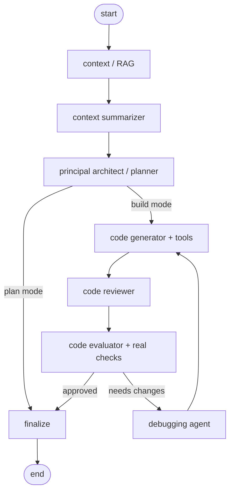

# Architecture

Orion is organised as a small set of layers that can be used independently:

```text
CLI (Typer) ─┐
TUI (Textual)┼──▶ OrionEngine ──▶ LangGraph agent graph ──▶ Tools
HTTP API ────┘         │                     │
                       │                     └──▶ GCloudLLM (Vertex AI via ADC)
                       └──▶ CodeRetriever ──▶ VectorStore (Chroma / JSON)
```

The agent pipeline never imports Textual or FastAPI. That keeps the engine
usable in scripts, servers, and tests.

## Packages

| Package | Responsibility |
| --- | --- |
| `orion.cli` | Typer commands, Rich output, interactive fallback. |
| `orion.tui` | Textual app, widgets, theme, slash commands, approval modals. |
| `orion.engine` | `OrionEngine`, `RunResult`, sessions, event streaming, cancellation. |
| `orion.agents` | Prompts, `AgentRuntime`, node functions, LangGraph wiring. |
| `orion.tools` | Tool definitions, mode-aware registry, path sandboxing, shell execution. |
| `orion.rag` | Chunker, embedders, vector stores, incremental indexer, retriever. |
| `orion.llm` | `google-genai` wrapper (`GCloudLLM` for Vertex AI via ADC, the default; `GeminiLLM` API-key and `LocalLLM` backends are legacy/optional), retries, model fallbacks, usage accounting, message conversion. |
| `orion.server` | Optional FastAPI app (install `orion-ai[server]`). |
| `orion.config` | Pydantic settings, `.env` discovery, derived paths. |
| `orion.session` | On-disk session metadata and event logs. |

## Agent graph



The graph is built in `orion.agents.graph.build_graph`. State is a typed dict
(`AgentState`) carrying the task, mode, retrieved context, plan, changes,
review, test results, and the final report.

Node names in code (`planner`, `coder`) map to the roles shown in the TUI
(`architect`, `generator`). Each role can use its own model via
`ORION_<ROLE>_MODEL`.

- **context** - builds a compact repository overview and retrieves the top-k
  chunks for the task. Retrieval failures degrade to lexical search rather than
  aborting the run.
- **summarizer** - compresses the context into a short briefing for the architect.
- **architect** (`planner` node) - in plan mode it runs a read-only tool loop and
  returns markdown. In build mode it asks for JSON, normalises it, and renders a plan.
- **generator** (`coder` node) - a ReAct-style tool loop. It can read, search,
  write, edit, move, delete, and run commands (subject to mode and approval).
- **reviewer** - reviews the diff. Verdicts are `approve` or `needs_changes`.
- **evaluator** - runs real test/lint/type-check commands (approval still
  applies) and combines them with an independent model verdict. Failed checks
  always block approval.
- **debugger** - converts failed evaluation/review findings into fix notes and
  loops back to the generator, up to `ORION_MAX_ITERATIONS`.
- **finalize** - assembles the final markdown report.
## Runtime and events

`AgentRuntime` owns the LLM client, tool registry, retriever, approval callback,
cancellation event, usage counters, and the change log. Nodes call
`runtime.event(...)`; the engine forwards each event to the caller and, when
session persistence is on, appends it to the session log.

`OrionEngine.stream` runs a task on a worker thread and yields events from a
queue, ending with a `done` event. `OrionEngine.run` is the synchronous form.

## Tool safety

- Every filesystem path is resolved and checked against the workspace root;
  escaping paths raise `ToolError`.
- Plan mode filters the tool schema list to read-only tools and also rejects
  write attempts at execution time (defence in depth).
- Shell commands pass a blocklist (`rm -rf /`, pipe-to-shell, etc.) and the
  approval policy:
  - `ask` — prompt for each command (TUI modal, CLI prompt).
  - `auto` — run without prompting.
  - `deny` — never run shell commands.
- `--dry-run` records the intended changes and diffs without touching disk.

## Retrieval pipeline

1. **Scan** — walk source files, honouring `.gitignore`/`.orionignore` and a
   built-in ignore list (`.venv`, `node_modules`, binaries, lockfiles, ...).
2. **Chunk** — split by lines into overlapping windows with a maximum character
   budget; each chunk records `path`, `start_line`, `end_line`, `language`, and
   a content hash.
3. **Embed** — Vertex embeddings (`text-embedding-005`, via ADC) or the offline
   `local-hash-v1` embedder. The embedder name is recorded; switching embedders
   triggers a reset so vectors are never mixed.
4. **Store** — ChromaDB with cosine distance, or a JSON store when Chroma is
   unavailable.
5. **Retrieve** — hybrid search combines vector similarity with lexical
   matching and de-duplicates by location before building the prompt context.

A manifest tracks file hashes so re-indexing only touches changed files.

## Sessions

Sessions are written under `<data_dir>/sessions/`. Each session has a JSON
metadata file and an append-only event log (tokens are not persisted). Use
`orion sessions list` / `orion sessions show <id>` or `/sessions` in the TUI.

